<p align="center">
  
</p>

<h1 align="center">NodeMaster</h1>

<p align="center">
  <strong>下一代多 VPS 节点全生命周期集中管控与自适应分流控制平台</strong><br />
  <em>Next-Generation Distributed VPS Management & Adaptive Traffic Shunting System</em>
</p>

<p align="center">
  
  
  
  
  
  
  
  
  <a href="https://github.com/SpeedupMaster/nodemaster/actions/workflows/docker-publish.yml">
    
  </a>
</p>

---

## 📖 项目简介 (Overview)

**NodeMaster** 是一套专为运维工程师、分布式节点管理者与高阶极客量身打造的下一代多 VPS 节点集中管控平台。

遵循 **Hallmark Modern-Minimal** 工程控制台设计美学与深邃暗黑视觉规范，NodeMaster 基于高性能 **GSAP 3** 动画渲染与毫秒级 WebSocket 双向数据流，实现多台云服务器硬件工况**真实网卡物理遥测**、**VLESS-Reality** 免证书协议组网、**Dokodemo-door** 链式中转解锁隧道、**全客户端自适应智能订阅分发**、多维度 **Telegram 自动化告警中心** 以及 **流量月度精准计量与超额自动熔断保护**。

> [!NOTE]
> **真实数据原则**：NodeMaster 坚持硬件实测遥测，Python 探针直接读取 Linux 内核 `/proc/net/dev` 真实流量差值与硬件计数器，绝不使用前端假动画或随机数伪造状态。

---

## 📸 界面预览与视觉体验 (Visual Showcase)

NodeMaster 拥有极具辨识度的现代化暗黑工况设计语言（Obsidian Cobalt 配色），在桌面端提供极高信息密度的运维工作台，在移动端提供原生的触控与抽屉体验。

### 1. 实时工况仪表盘 (Live Telemetry Dashboard)
全节点在线状态实时总览、全网出入吞吐双向滚浪计数（Rolling Counter）、各主机 CPU/内存/磁盘环形刻度、网卡实时上下行速率与系统运行时长：

<p align="center">
  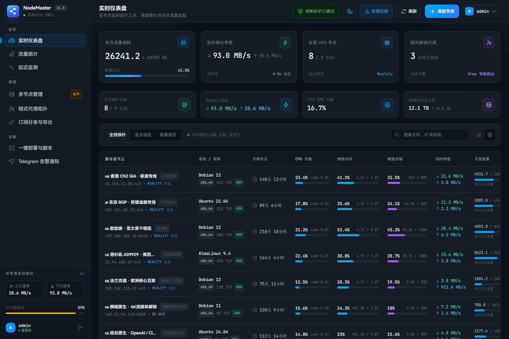
</p>

---

### 2. 多 VPS 节点全维度管理 (Node Fleet Management)
支持 VLESS-Reality 主力直连、Shadowsocks 原生解锁及独立探针节点混合编排；直观呈现 Reality SNI 伪装域名、国内 TCP 延迟、月度配额进度条、到期提醒与自动续费标记：

<p align="center">
  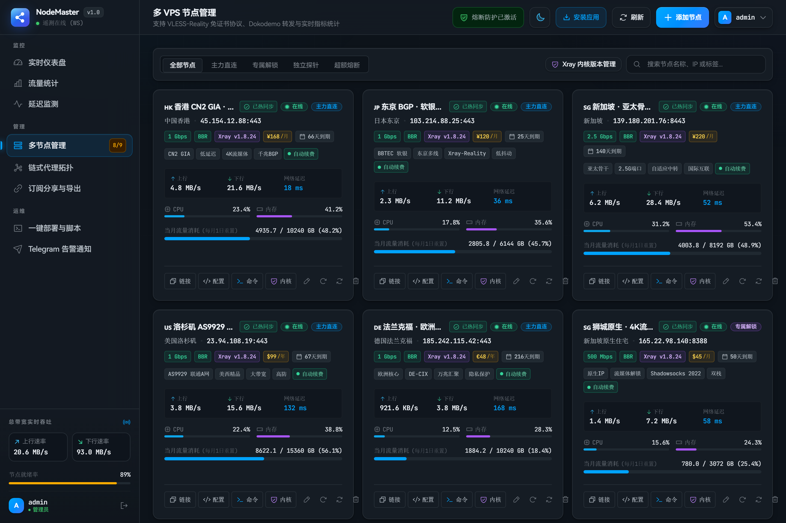
</p>

---

### 3. 节点硬件深度遥测与多点测速弹窗 (Node Detail & Multi-Point Ping)
点击任意节点即可展开深度工况抽屉：精准呈现内核负载（Load Average 1/5/15m）、物理内存与磁盘结构、24 小时流量时序走势，以及针对国内三大运营商（电信/联通/移动）9 大测速节点的实时 TCP 往返时延（RTT）与抖动曲线：

<p align="center">
  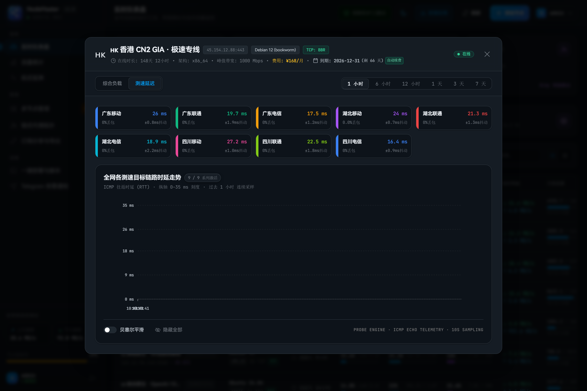
</p>

---

### 4. 链式代理与落地解锁拓扑 (Chain Proxy & Unlock Topology)
基于 GSAP 动态数据流拓扑画布：直连主力入口机（香港/日本/新加坡）通过 Dokodemo-door 链式隧道将 OpenAI、Claude、Netflix、Disney+ 等受风控流量动态分流至原生住宅 ISP 落地机，既享受骨干千兆低延迟，又完美规避落地 IP 暴露：

<p align="center">
  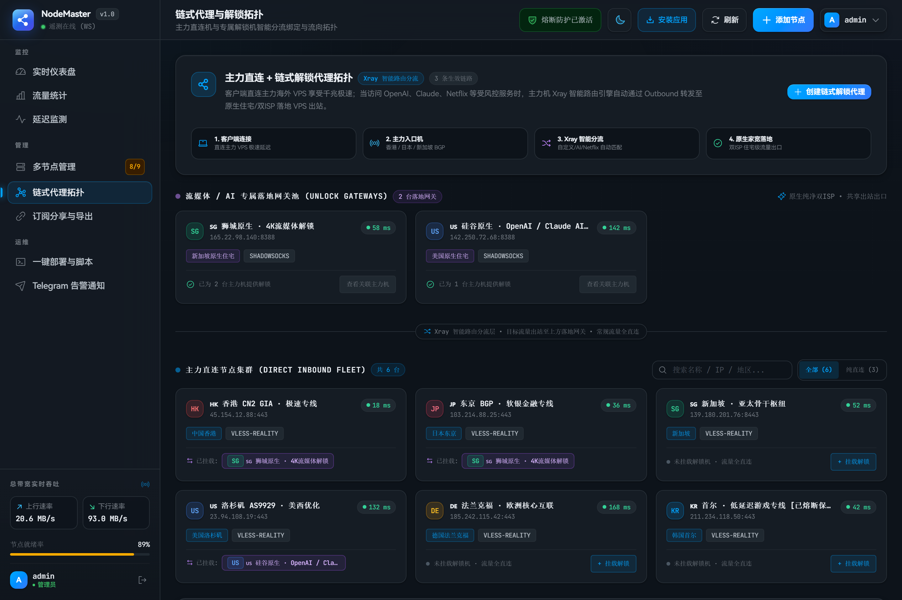
</p>

---

### 5. 全局流量计量与多维时序分析 (Traffic Analytics & Distribution)
支持按“今日 (24h)”、“近 7 天”、“近 30 天”、“本自然月”及“全部历史”多维度切片，统计网卡实测出入流量总和、峰值小时吞吐、节点流量占比排行与每小时聚合时序柱状图：

<p align="center">
  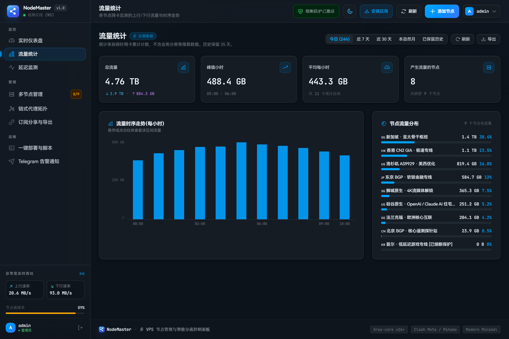
</p>

---

### 6. 三大运营商国内多点延迟时序监测 (Latency Matrix)
VPS 探针周期性针对中国电信、中国联通、中国移动全国多个主流骨干机房发起 TCP 探测，多视图支持任务维度与服务器矩阵自由切换：

<p align="center">
  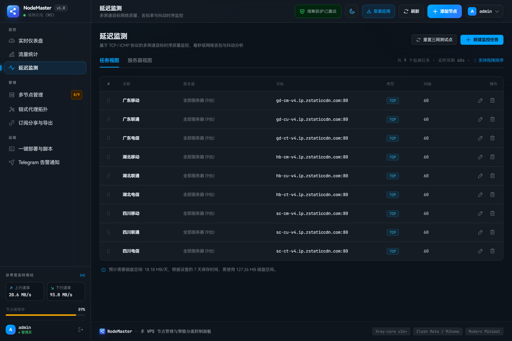
</p>

---

### 7. 全客户端自适应智能订阅分发 (Adaptive Subscription)
通过统一订阅端点 `/api/sub/:token`，依据发起请求的客户端 `User-Agent` 动态输出最适配的配置格式（Clash Meta / Mihomo、Sing-box、Egern、Shadowrocket / Base64），内置防封锁落地保护、Clash 一键导入与二维码扫码直连：

<p align="center">
  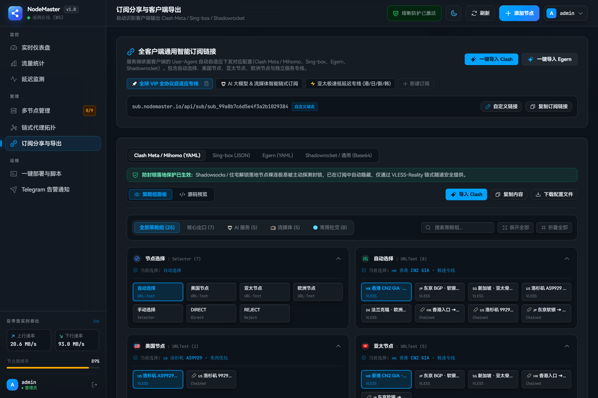
</p>

---

### 8. 一键部署纳管与 BBR 深度网络调优 (Deploy & BBR Tuning)
自动生成专有 Token 的轻量纳管指令，一键识别 Linux 架构（x86_64 / arm64）并拉取官方校验版 Xray-core 二进制；内置 TCP-Dashboard 跨境网络深度优化套件（BBR+FQ 算法、5% 内存动态缓冲区、1,048,576 句柄池扩展与 MTU 黑洞探测）：

<p align="center">
  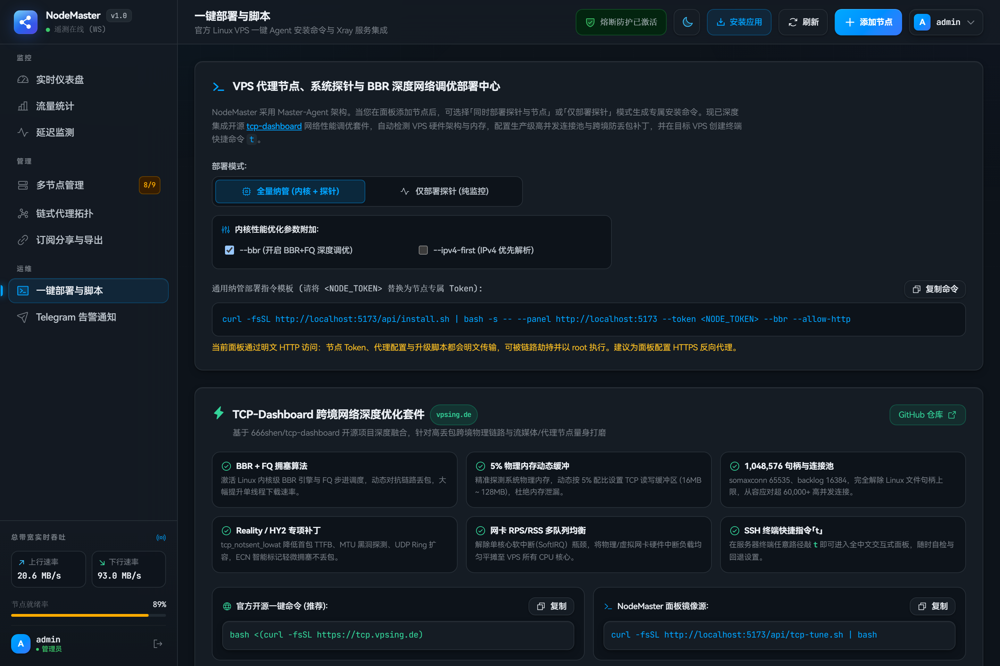
</p>

---

### 9. Telegram 自动化告警中心 (Telegram Notification Hub)
全天候 24/7 守护守护进程：涵盖节点离线报警、心跳恢复通知、月度流量 80% 阈值告警、超额自动熔断保护、主机 7 天到期续费提醒与 CPU/内存持续高负载排查日志：

<p align="center">
  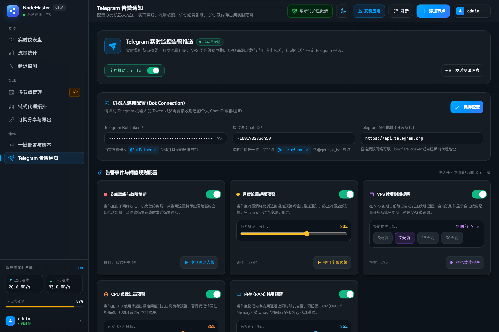
</p>

---

### 10. 移动端与 PWA 渐进式体验 (Mobile & Standalone Experience)
严格遵循 **WCAG 2.2 AA** 高对比度无障碍标准，移动端自适应深邃无界网格布局，支持 iOS 防缩放（16px+）、44px+ 拇指触控热区、原生底部抽屉（Bottom Sheet）与 PWA 一键安装至桌面：

<p align="center">
  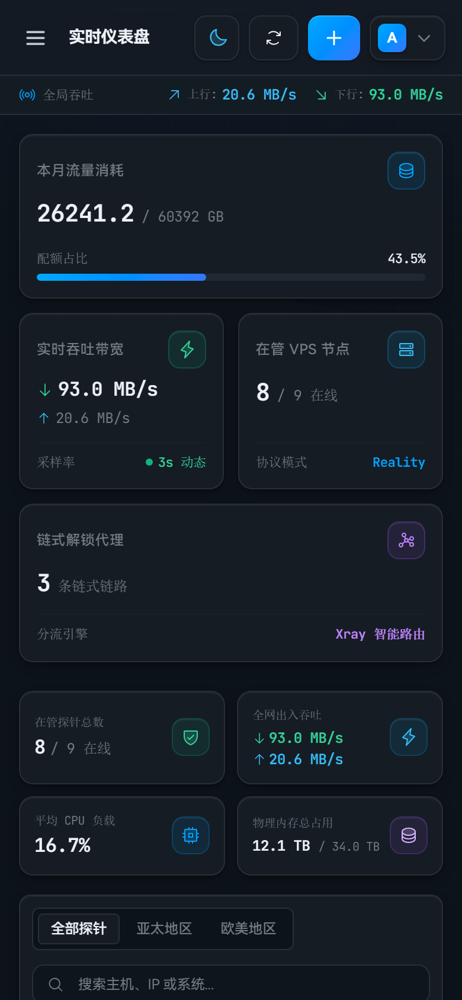
  &nbsp;&nbsp;&nbsp;&nbsp;
  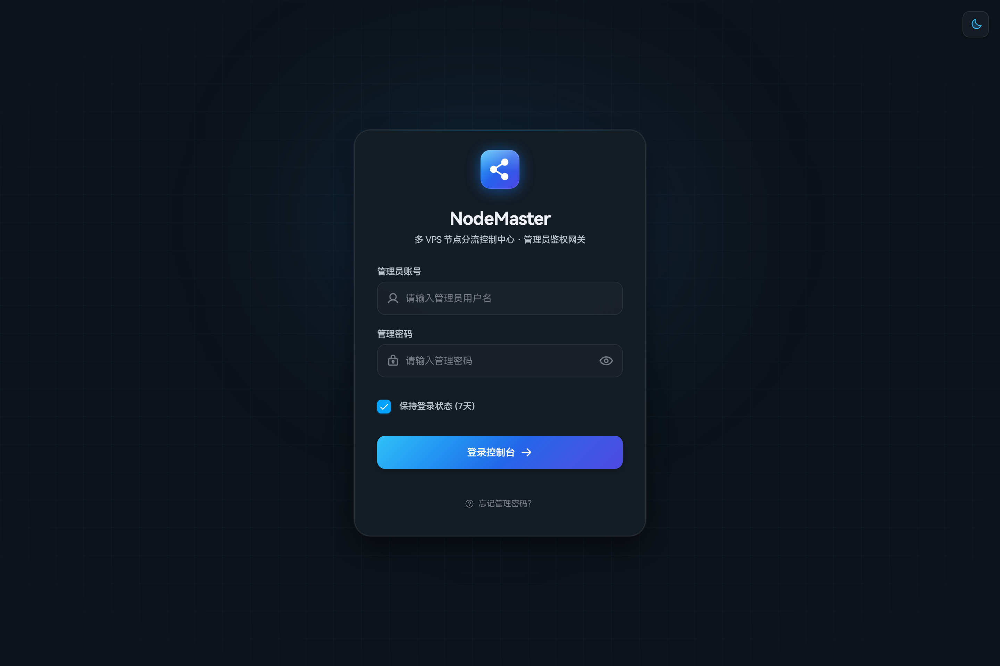
</p>

---

## ✨ 核心特性深度解析 (Key Features)

### 1. 🛡️ 零信任安全网关与会话原子隔离
- **100,000 轮 PBKDF2 强哈希**：密码基于 PBKDF2 (SHA-512) 单向散列并结合独立 Salt，数据库与内存永不存留明文。
- **原子隔离 JWT 会话吊销**：基于 HMAC-SHA256 签名，密码修改或主动退出登录时触发 `sessionVersion` 原子递增，旧会话即刻全网吊销，杜绝凭据泄漏后患。
- **暴力破解防护**：内置 IP 频次速率限制（Rate Limiting），防止自动化爆破。

### 2. ⚡ 全协议支持与 30 秒极速纳管
- **原生 VLESS-Reality**：免购买与申请 SSL 证书，借用 Microsoft、Apple 等主流网站 SNI 证书流量伪装，抗主动探测与中间人阻断。
- **Dokodemo-door 链式中转隧道**：国内/前置优化机接入并链式转发至海外落地机，保护落地原生住宅 IP 安全与风控等级。
- **30 秒一键安装脚本**：
  ```bash
  curl -fsSL "https://your-panel-domain.com/api/install.sh" | bash -s -- --panel "https://your-panel-domain.com" --token "<NODE_TOKEN>"
  ```
  自动匹配 CPU 架构（x86_64 / arm64），配置 systemd 守护进程与平滑热重载。

### 3. 📊 真实硬件遥测与多节点探针矩阵
- **内核级网卡流量计数**：Python 3 轻量探针直接读取 `/proc/net/dev` 真实硬件网络接口收发字节数，准确统计业务吞吐。
- **全维度节点工况遥测**：实时上报 CPU 使用率、物理内存用量、磁盘剩余、系统负载（LoadAvg 1/5/15m）、TCP 活跃连接数、UDP 连接数与开机时长。
- **国内三网延迟时序矩阵**：VPS 节点周期性测试针对中国电信、中国联通、中国移动各大骨干机房的 TCP / ICMP 延迟与网络抖动，绘制连续时序变化曲线。

### 4. 🌐 客户端自适应智能订阅分发
统一接入点 `/api/sub/:token`，依据客户端 `User-Agent` 动态分流并自动组装渲染：
- **Clash Meta / Mihomo**：自动装配策略组（🚀 节点选择、♻️ 自动选择、🤖 AI 专用服务、📺 流媒体分流、🎯 全球直连、🐟 漏网之鱼）及 GEOIP/GEOSITE 规则集。
- **Sing-box**：渲染标准 JSON 出站配置、DNS 路由与出站分流规则。
- **Shadowrocket / Egern / 通用客户端**：Base64 动态安全节点流与专用格式。
- **一键导入与配额管控**：支持 `clash://install-config?url=...` 快速唤醒、二维码直扫导入，可按订阅设置到期日（`expireAt`）与独立流量额度。

### 5. 🛑 流量精准计量与超额自动熔断保护
- **全自动熔断器 (Circuit Breaker)**：当月度总用量达到设定的阈值（例如 98%）时，系统自动切断节点入站，防止因跑飞流量产生巨额超额账单。
- **智能月度重置**：支持指定每月任意日期（如每月 1 日）定时重置，遇到小月无 31 日时自动取当月最后一天，重置后自动解除熔断并恢复节点代理。

### 6. 🤖 Telegram 自动化告警中心
- **节点离线即时推报**：探针心跳中断（超 30 秒无遥测数据）自动推送报警。
- **月度额度阈值预警**：流量消耗达到预设阈值（如 80%、90%）即时下发推送提醒。
- **VPS 续费到期提醒**：根据配置的服务器到期日提前 7 天每日告警，避免服务器因未续费被云厂商回收。
- **系统高负载告警**：支持 CPU 或内存超标（如持续 > 85%）推报预警。

---

## 🛠️ 系统技术架构 (Architecture)

```text
┌─────────────────────────────────────────────────────────────────────────┐
│                      NodeMaster 控制中台 (Web UI)                       │
│        React 19 + TypeScript + Tailwind CSS + GSAP 3 + Phosphor         │
└────────────────────────────────────┬────────────────────────────────────┘
                                     │  REST API + WebSocket (双向遥测数据流)
┌────────────────────────────────────▼────────────────────────────────────┐
│                      NodeMaster 核心后端 (Node.js 24)                   │
│          Express + ws Hub + PBKDF2/JWT + JSON 原子并发持久化引擎        │
└──────────────────┬──────────────────────────────────┬───────────────────┘
                   │ 智能订阅分发                     │ 探针指令下发 / 遥测上报
                   ▼                                  ▼
        ┌─────────────────────┐            ┌─────────────────────────────┐
        │ 客户端自适应矩阵    │            │ VPS 节点矩阵 (Linux Fleet)  │
        │  • Clash Meta       │            │  • Python 3 轻量硬件探针    │
        │  • Sing-box         │            │  • Xray-core (VLESS Reality)│
        │  • Egern / Surge    │            │  • Shadowsocks-2022 解锁机  │
        │  • Shadowrocket     │            │  • Dokodemo-door 链式隧道   │
        └─────────────────────┘            └─────────────────────────────┘
```

---

## 🚀 快速启动与部署 (Quick Start)

### 🐳 方式一：Docker 一键部署（推荐）

NodeMaster 官方预编译镜像托管于 GitHub Container Registry (GHCR)，原生支持 `linux/amd64` 与 `linux/arm64` 双架构。

#### 1. 单命令启动容器
```bash
docker run -d \
  --name nodemaster \
  --restart unless-stopped \
  -p 3880:3880 \
  -v nodemaster_data:/app/server/data \
  -e NODEMASTER_ADMIN_PASSWORD="YourStrongPassword123" \
  ghcr.io/speedupmaster/nodemaster:latest
```

#### 2. 使用 Docker Compose 部署
项目根目录已内置 `docker-compose.yml`：
```bash
# 1. 启动容器集群
docker-compose up -d

# 2. 实时查看运行日志
docker-compose logs -f
```

---

### 💻 方式二：源码安装运行

#### 环境要求
- **服务端**：Node.js >= 22.0.0（推荐 Node.js 24 LTS）、pnpm >= 9.0.0
- **VPS 节点**：Linux（Debian 11+/12+、Ubuntu 20.04+/22.04+/24.04+、CentOS 8+/AlmaLinux 9+）、systemd、Python >= 3.6

#### 1. 构建并运行生产版本
服务端已内置静态资源托管，打包后仅需对外开放单端口（3880）：
```bash
# 1. 克隆代码仓库
git clone https://github.com/SpeedupMaster/nodemaster.git
cd nodemaster

# 2. 安装项目全部依赖
pnpm install

# 3. 编译前端与后端
pnpm build

# 4. 启动服务 (默认端口 3880)
pnpm start
```
服务就绪后，在浏览器中访问：**`http://localhost:3880`**。

#### 2. 本地开发模式 (支持 Vite 热更新)
同时启动 Vite 开发服务器（5173 端口）与后端 API（3880 端口）：
```bash
pnpm dev
```
- 前端热更新地址：**`http://localhost:5173`**
- 后端 API 服务地址：**`http://localhost:3880`**

---

### 🎲 填充全套演示数据与测试

为了方便体验、评估大屏界面或截取高保真展示图，仓库已内置开箱即用的演示数据生成套件：

```bash
# 1. 一键填充 9 大节点、3 条链式解锁隧道、3 组自适应订阅、432 条工况样本与 3888 条测速数据
pnpm seed:demo

# 2. 使用 Headless Chrome 自动化截取全套 11 张超清暗黑工况大屏截图
pnpm screenshots
```

---

## ⚙️ 环境变量与反向代理安全指南 (Configuration)

### 环境变量说明

支持通过根目录 `.env` 或系统环境变量调整配置：

| 环境变量 | 默认值 | 作用说明 |
| :--- | :--- | :--- |
| `PORT` | `3880` | 服务端监听端口 |
| `HOST` | `0.0.0.0` | 绑定的监听 IP 地址 |
| `NODEMASTER_DATA_DIR` | `server/data` | 运行时数据目录（数据库、遥测历史、初始凭据），需持久化挂载 |
| `NODEMASTER_ASSETS_DIR` | `server/data` | 随版本发布的安装脚本、探针与订阅模板目录（Docker 镜像中为 `/app/server/assets`） |
| `NODEMASTER_ADMIN_PASSWORD` | *(自动生成随机)* | **仅首次部署**时的管理员密码（至少 8 位）；若未设置，初次密码保存至 `data/bootstrap-admin.txt` |
| `NODEMASTER_RESET_ADMIN_PASSWORD` | *(空)* | 忘记密码恢复通道：启动时重置管理员密码为该值并全网吊销旧会话，**生效后请立即删除** |
| `TRUST_PROXY` | *(关闭)* | 部署在 Nginx / Caddy 反向代理之后时设置（如 `1` 或 `loopback`），确保正确获取客户端真实 IP 与 HTTPS 协议 |

---

### 🔒 反向代理与 HTTPS 配置建议

管理密码、探针 Token 与 Reality 私钥传输建议通过 HTTPS 保障安全。以 **Nginx** 为例：

```nginx
server {
    listen 443 ssl http2;
    server_name panel.example.com;

    ssl_certificate /etc/letsencrypt/live/panel.example.com/fullchain.pem;
    ssl_certificate_key /etc/letsencrypt/live/panel.example.com/privkey.pem;

    location / {
        proxy_pass http://127.0.0.1:3880;
        proxy_http_version 1.1;
        proxy_set_header Host $host;
        proxy_set_header X-Forwarded-For $proxy_add_x_forwarded_for;
        proxy_set_header X-Forwarded-Proto $scheme;

        # WebSocket 长连接支持 (/ws)
        proxy_set_header Upgrade $http_upgrade;
        proxy_set_header Connection "upgrade";
    }
}
```

> [!TIP]
> 使用反向代理后，请务必设置 `TRUST_PROXY=1`，并将 NodeMaster 端口绑定到本地回环（如 Docker 使用 `-p 127.0.0.1:3880:3880`）。使用 Caddy 的用户只需配置 `reverse_proxy 127.0.0.1:3880`。

---

## 🔑 管理员凭据与安全重置 (Authentication)

NodeMaster 遵循零信任安全原则：
- **初始管理员账号**：`admin`
- **查看初次随机密码**：
  若启动容器时未指定 `NODEMASTER_ADMIN_PASSWORD`，首次启动会在数据目录自动生成强随机凭据文件：
  ```bash
  cat server/data/bootstrap-admin.txt
  ```
  *初次登录后，请立即在控制台右上角菜单修改密码，系统将自动失效并清理该文件。*
- **忘记管理密码应急恢复**：
  若遗忘密码，配置环境变量 `NODEMASTER_RESET_ADMIN_PASSWORD` 并重启服务：
  ```bash
  NODEMASTER_RESET_ADMIN_PASSWORD="YourNewStrongPassword" pnpm start
  ```
  登录成功后请**删除该环境变量**并重启，以恢复控制台修改密码功能。

---

## 📁 目录结构 (Directory Structure)

```text
nodemaster/
├── package.json              # Monorepo 根配置与快捷指令
├── pnpm-workspace.yaml       # pnpm 多模块工作区编排
├── docker-compose.yml        # Docker 生产编排配置
├── Dockerfile                # 多阶段极简容器构建文件
├── scripts/                  # 自动化运维、演示数据与截图脚本
│   ├── seed-demo.mjs         # 演示数据一键填充脚本
│   └── capture-screenshots.mjs# Headless Chrome 自动化截屏脚本
├── docs/                     # 项目设计文档与资产
│   └── screenshots/          # 系统高清暗黑大屏截图集
├── shared/                   # 前后端共享 TypeScript 类型定义
│   └── types.d.ts            # NodeItem, RelayLink, Subscription, Telemetry
├── web/                      # 前端现代控制台 (React 19 + Vite + Tailwind + GSAP)
│   ├── src/
│   │   ├── components/
│   │   │   ├── auth/         # 登录网关、无障碍底部抽屉、改密弹窗
│   │   │   ├── dashboard/    # 概览大屏、硬件刻度、实时双向滚浪计数
│   │   │   ├── layout/       # 响应式侧边栏、顶部导航、暗黑模式切换
│   │   │   ├── nodes/        # 多 VPS 节点卡片、配置查看、纳管弹窗
│   │   │   ├── notifications/# Telegram 自动化报警与审计日志面板
│   │   │   ├── ping/         # 国内运营商多点延迟时序图表
│   │   │   ├── probe/        # VPS 硬件深度遥测抽屉与时序走势
│   │   │   ├── subscription/ # 自适应多客户端订阅分发与策略组
│   │   │   ├── topology/     # GSAP 链式解锁拓扑与动态流光动效
│   │   │   └── traffic/      # 全局业务流量统计与节点带宽分析
│   │   ├── hooks/useData.ts  # 双向遥测、REST 聚合请求管理
│   │   └── styles/           # Hallmark 设计代币与全局样式
│   └── index.html
└── server/                   # 后端核心引擎 (Node.js 24 + Express + ws)
    ├── src/
    │   ├── db/               # JSON 原子持久化与数据迁移
    │   ├── routes/           # REST API 路由与自动化下发
    │   ├── services/
    │   │   ├── authService.ts      # PBKDF2 与 JWT 零信任安全服务
    │   │   ├── historyStore.ts     # 遥测历史紧凑存储与分层聚合
    │   │   ├── subscription.ts     # 多客户端订阅自适应转换引擎
    │   │   ├── telemetryService.ts # 探针物理遥测接入与熔断判定
    │   │   ├── wsHub.ts            # WebSocket 遥测中心与心跳保活
    │   │   └── xrayConfig.ts       # Reality / Dokodemo 密钥与配置装配
    │   └── index.ts          # 入口服务与静态资源托管
    └── data/                 # 节点数据、初始凭据、安装与探针脚本
```

---

## 📄 开源许可证 (License)

本项目基于 [MIT License](LICENSE) 协议开源，欢迎自由使用、审查或二次开发。
